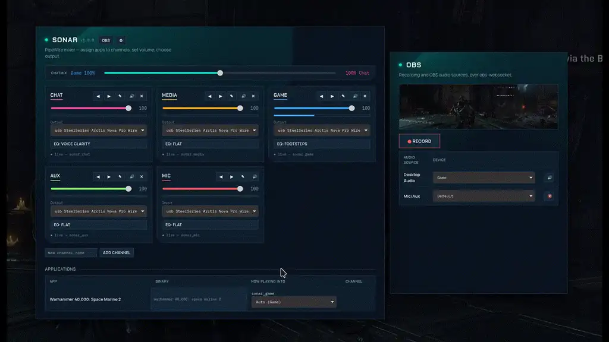

# Sonar — a SteelSeries GG Sonar clone for Linux

A virtual audio mixer that splits your system audio into independent channels (Game / Chat /
Media / Aux), routes each application into a channel, gives every channel its own volume and
mute, and routes each channel to a physical output — all in software, on top of **PipeWire**.

Built as a **Java / Spring Boot** learning project.



## Features (implemented)

- **Channels** — Game, Chat, Media and Aux are created automatically as virtual devices
  (PipeWire null-sinks). Any app can target them.
- **Application routing** — assign a running app to a channel; the assignment is remembered
  (by process binary name) and re-applied when the app restarts.
- **Per-channel volume & mute** — independent sliders, applied live to PipeWire.
- **Device selection** — choose which physical output (headphones vs. HDMI) each channel
  routes to.
- **ChatMix** — one dial that balances Game against Chat: centre = both full, turning towards one
  side fades the other. Scales on top of each channel's own volume. On an **Arctis Nova Pro
  Wireless**, the base station's hardware ChatMix dial drives it too (see below).
- **OBS remote** — its own window (the mixer's OBS button); while OBS runs: start / pause / resume / stop recording, and per OBS audio
  source pick its device (Sonar channels included, e.g. record Game but not Chat) and mute it.
- **EQ & profiles** — 10-band EQ (31 Hz–16 kHz, ±12 dB) on every channel, mic included, changed
  live while you drag. Built-in presets (Flat, Bass Boost, Footsteps, Voice Clarity, Treble Boost)
  plus your own saved profiles.
- **Persistence & recovery** — channels, volumes and assignments survive restart; orphaned
  modules from a crash are cleaned up on the next boot.
- **Mic channel** — a virtual mic (`sonar_mic`) over the physical mic of your choice, with its
  own volume/mute and EQ. The real mic is only opened while an app records from `sonar_mic`
  (and for 5 s after), so the desktop's "mic in use" indicator stays off otherwise.
- **Auto-routing** — unassigned apps go to the channel they most likely belong in (Steam games →
  Game, chat apps → Chat, players/browsers → Media), guessed from Steam's env, the stream's
  `media.role` and the app's `.desktop` categories. Can be turned off in Preferences.
- **Level meters** — live peak meter per channel.
- **Rename & reorder channels** — from the channel card.
- **Unplug-safe** — if a channel's output disappears, PipeWire falls back to the default output
  and moves it back when the device returns.
- **Web mixer UI** — served at `http://localhost:8080`.
- **Desktop window & overlay** — `sonar-window.py` (WebKitGTK) shows the mixer as a window, or
  `--toggle` shows it as a full-screen overlay bound to a global hotkey.

## Not yet implemented

- Per-game spatial audio (out of scope — no good Linux primitive).

## How it works

The app drives PipeWire by shelling out to its native CLI tools (`pactl` via the
`pipewire-pulse` compatibility layer). There is no maintained Java binding for libpipewire,
so this is the standard, robust approach:

| Feature | Command |
|---|---|
| Create a channel | `pactl load-module module-null-sink sink_name=sonar_game …` |
| Route channel → output, with EQ | a `pipewire -c <conf>` child running `module-filter-chain`: reads `sonar_game.monitor`, plays into `<device>` |
| Move an app to a channel | `pactl move-sink-input <index> <sink>` |
| Virtual mic, with EQ | the same filter-chain child: reads `<mic>`, and is itself the `sonar_mic` source |
| Change EQ live | `pw-cli set-param sonar_game_eq_in Props '{ params = [ "b0:Gain" 3.0 … ] }'` |
| Set volume / mute | `pactl set-sink-volume` / `pactl set-sink-mute` |
| Discover apps | poll `pactl list sink-inputs` every ~1s |

The EQ can't be a `pactl` module (`pipewire-pulse` doesn't offer `module-filter-chain`), and
`pw-cli load-module` unloads a module when pw-cli exits, so each channel's EQ is its own
long-lived `pipewire` process with a generated config in `$XDG_RUNTIME_DIR/sonar-eq/`. Each band is a
built-in peaking biquad, so no LADSPA/LV2 plugins are needed.

**Gotcha:** PipeWire module ids are ephemeral and reused. The app never trusts a persisted id
across sessions — on boot it unloads any `sonar_*` modules, then recreates every channel from
scratch and stores the fresh ids. Leftover EQ processes from a crash are found by their config
path and stopped the same way.

## Requirements

- Linux with PipeWire + `pipewire-pulse` (provides `pactl`) and `pw-cli`/`pw-link`.
- Java 21. No Maven install needed — the wrapper (`./mvnw`) is checked in.

### Desktop window & overlay

`sonar-window.py` needs PyGObject with GTK 3 and WebKitGTK 4.1 (`python-gobject` + `webkit2gtk-4.1`
on Arch, `python3-gobject` + `webkit2gtk4.1` on Fedora). The overlay also wants **gtk-layer-shell**,
which puts it on a layer above everything, fullscreen games included, without taking their focus.
On Bazzite: `rpm-ostree install gtk-layer-shell`, then reboot.

> **GNOME users:** GNOME doesn't implement layer-shell, so there the overlay falls back to a plain
> fullscreen window that stays on top. It works on the desktop, but a fullscreen game may minimize
> when it opens. The windowed mixer is unaffected. The same fallback applies anywhere
> gtk-layer-shell isn't installed. The **Meta+S** hotkey is set up automatically on KDE only; on
> GNOME, add a custom shortcut (Settings → Keyboard → Custom Shortcuts) running
> `/path/to/sonar-window.py --toggle`.

### OBS

Sonar talks to OBS over **obs-websocket v5**, built into OBS 28+, using the JDK's WebSocket
client. Port and password are read from OBS's own config
(`~/.config/obs-studio/plugin_config/obs-websocket/config.json`), so there's nothing to configure in
Sonar; just enable the server once in OBS: **Tools → WebSocket Server Settings → Enable**.
When OBS isn't running the OBS section says so and the rest of Sonar is unaffected.

### Arctis Nova Pro Wireless base station (ChatMix dial, battery, mic mute)

The base station only reports its dial when told to (that's what SteelSeries' Windows Sonar does).
Sonar sends that command over the base's vendor HID interface (`/dev/hidraw*`, interface 4) and
reads the dial from it. Protocol from [nova-chatmix-linux](https://github.com/Dymstro/nova-chatmix-linux).
The hidraw node is root-only by default; this udev rule gives the logged-in user access:

```sh
sudo cp udev/70-steelseries-arctis.rules /etc/udev/rules.d/
sudo udevadm control --reload && sudo udevadm trigger
```

Over the same interface Sonar reads the headset's battery and the spare battery charging in the
base (shown next to the version, polled every 30 s), and mirrors the headset's mic-mute button
onto the Mic channel. Status layout from [HeadsetControl](https://github.com/Sapd/HeadsetControl).

Without the rule or the headset, Sonar runs normally and keeps looking every 5 s.

## Install (desktop app)

```sh
install/install.sh
```

Sets Sonar up for your user: the backend as a systemd user service that starts at login (with a
small-app JVM: 128 MiB heap, serial GC), the **Sonar** launcher, the **Meta+S** overlay hotkey,
and the icon. It builds `target/sonar.jar` first if needed, and fills in the repo's location, so
re-run it after moving the repo. The files it installs are templates in `install/`.

Deploying a change: `systemctl --user stop sonar && ./mvnw package && systemctl --user start sonar`
(stop first: replacing the jar under a running JVM breaks its shutdown cleanup).

## Run

```sh
./mvnw spring-boot:run
```

Open `http://localhost:8080`. Play something into a channel to see it appear:

```sh
pw-play --target=sonar_game somefile.wav
```

The H2 console (to inspect persisted state) is at `http://localhost:8080/h2-console`
(JDBC URL `jdbc:h2:file:./data/sonar`, user `sa`, empty password).

## Stack

- Spring Boot 4.1, Java 21, Maven (wrapper)
- Spring Web MVC, Spring Data JPA, H2 (file mode)
- Static HTML/JS frontend (no framework)

## Project layout

```
src/main/java/dev/sonar/
  pipewire/       PipeWireService (all pactl calls + parsing), PipeWireModels
  domain/         Channel, AppAssignment, Preferences, EqProfile (bands + presets)
  repo/           Spring Data repositories
  service/        MixerService (business rules), Bootstrapper, StreamWatcher (polling),
                  AppClassifier (auto-routing), LevelMeter
  obs/            ObsClient (obs-websocket v5)
  web/            MixerController, ObsController (REST), ApiErrors
src/main/resources/
  application.yml
  static/index.html  mixer; static/obs.html  OBS window; sonar.css + common.js shared by both
```

## API

| Method | Path | Purpose |
|---|---|---|
| GET | `/api/channels` | list channels |
| POST | `/api/channels` | create channel `{name}` |
| DELETE | `/api/channels/{id}` | delete channel |
| POST | `/api/channels/{id}/volume` | `{volume: 0-100}` |
| POST | `/api/channels/{id}/mute` | `{muted: bool}` |
| POST | `/api/channels/{id}/device` | `{deviceName}` |
| POST | `/api/channels/{id}/name` | `{name}` (display name; sink name stays) |
| POST | `/api/channels/order` | `[id, …]` in the new order |
| POST | `/api/channels/{id}/eq` | `{gains: [10 × dB]}`, applied live |
| GET | `/api/eq` | `{bands, maxGain, profiles}` |
| POST | `/api/eq/profiles` | `{name, gains}`: create or overwrite a custom profile |
| DELETE | `/api/eq/profiles/{id}` | delete a custom profile (presets are read-only) |
| POST | `/api/chatmix` | `{mix: -100 (all Game) .. 100 (all Chat)}` |
| GET | `/api/obs` | `{reason, recording: {active, paused, timecode}, inputs: [{name, muted, deviceId, devices}]}`; `reason` set when OBS is unavailable |
| POST | `/api/obs/record` | `{action: start \| stop \| pause \| resume}` |
| POST | `/api/obs/input` | `{name, muted}` and/or `{name, deviceId}` |
| GET | `/api/levels` | channel id → peak level 0-100 |
| GET | `/api/apps` | running apps + current channel |
| POST | `/api/route` | `{binary, displayName, channelId}` (channelId null = unassign) |
| GET | `/api/devices` | physical output devices |
| GET | `/api/sources` | physical mics |
| GET/PUT | `/api/preferences` | `{hotkeyOpens, autoRoute, meters, chatMix}` (PUT ignores `chatMix`) |

Bad input (unknown channel, duplicate or empty name, missing field, OBS refusing a request) returns
**400** with the reason as the body; OBS not running returns **503**.
